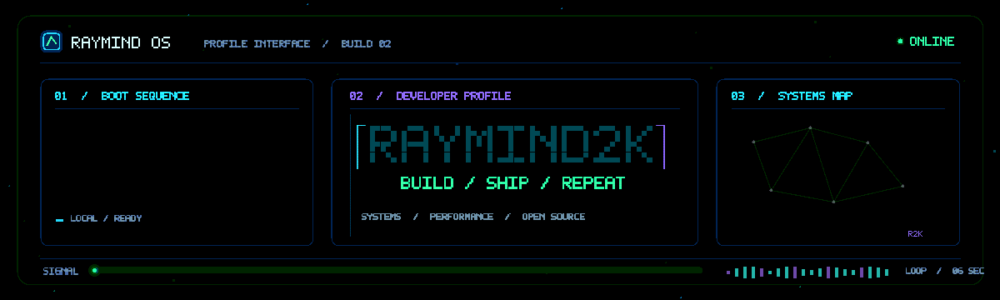
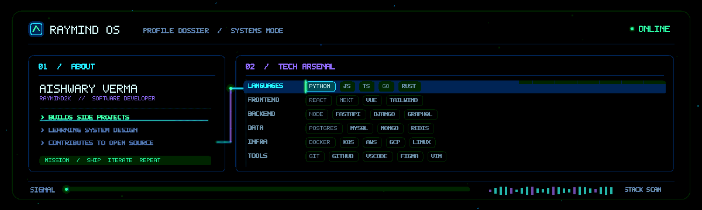
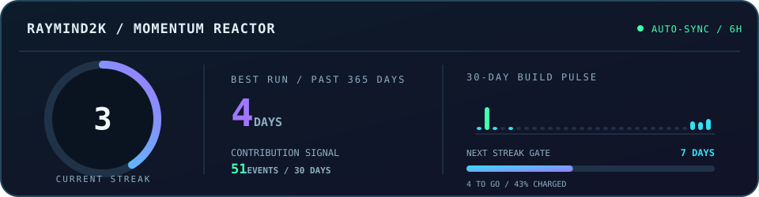

<!-- RAYMIND OS / animated profile -->

  

<strong>Turning caffeine into code, one commit at a time.</strong>

  <a href="#about-and-stack">ABOUT + STACK</a> &nbsp;·&nbsp;
  <a href="#momentum-reactor">MOMENTUM REACTOR</a> &nbsp;·&nbsp;
  <a href="#github-activity">GITHUB ACTIVITY</a> &nbsp;·&nbsp;
  <a href="#connect">CONTACT</a>

  
  
  

---

## 🧠 About + 🛠️ Tech Arsenal

  

BUILD SIDE PROJECTS · LEARN SYSTEMS · SHIP CLEAN CODE

---

## ⚡ Momentum Reactor

  

PUBLIC CONTRIBUTIONS · REFRESHES EVERY SIX HOURS · PRIVATE ACTIVITY IS NOT INCLUDED

---

## 🐍 GitHub Activity

  <picture>
    <source media="(prefers-color-scheme: dark)" srcset="https://raw.githubusercontent.com/Raymind2k/Raymind2k/output/github-contribution-grid-snake-dark.svg">
    <source media="(prefers-color-scheme: light)" srcset="https://raw.githubusercontent.com/Raymind2k/Raymind2k/output/github-contribution-grid-snake.svg">
    
  </picture>

---

## 🌐 Connect

  
  
  
  

Thanks for visiting · built with Markdown, motion, and a lot of ☕

